# Commons Node View

A small web console for a Bitcoin node, from [Bitcoin Commons](https://thebitcoincommons.org/). One download, one page
in your browser. It shows you what your node is doing (sync progress, peers on a globe, new blocks, logs) and, if you
want, it can also **download and run a node for you**. It never touches a wallet or any funds.

> The product is called **Commons Node View**. The repository, the Docker image and the Rust crate keep their old names:
> `blvm-ui` (repo and image) and `blvm-ui-next` (crate and binary). The commands below use those names.

| Home | Settings | First start |
|---|---|---|
| 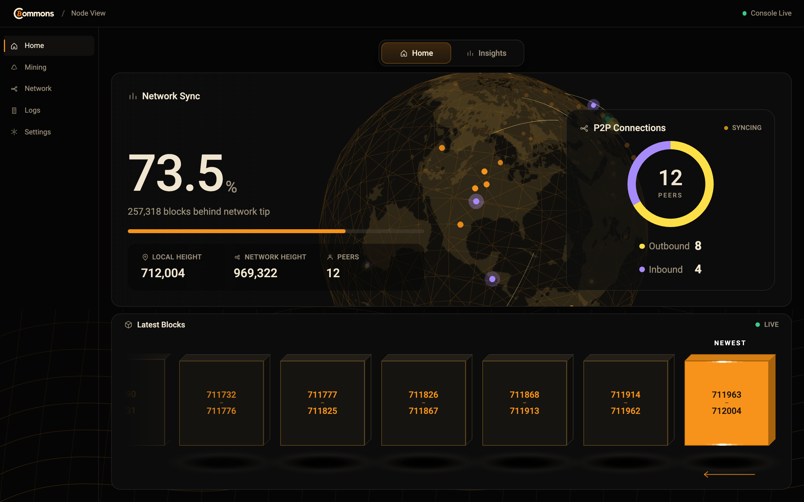 | 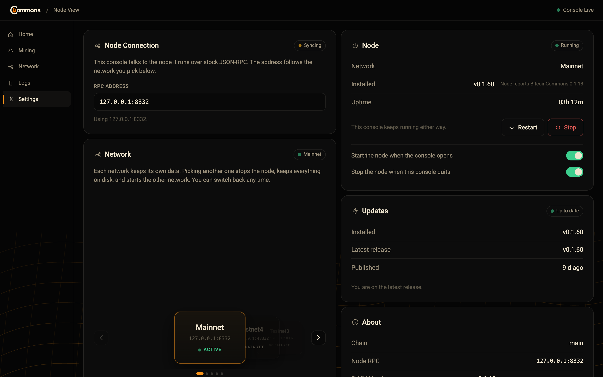 | 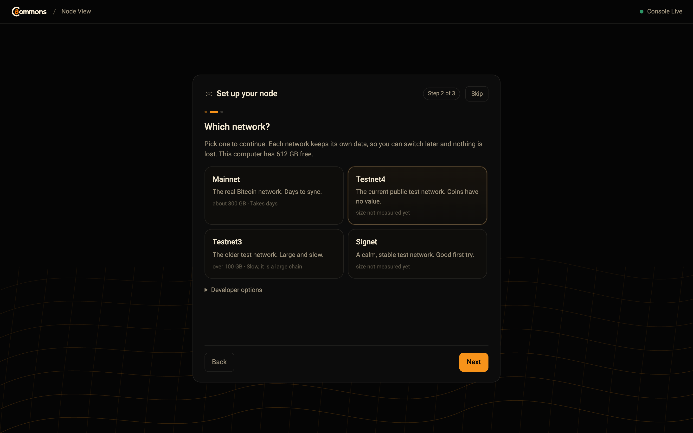 |

It is a Svelte 5 + Tailwind v4 page served by a small Rust program (the "host"). The host asks the node for its state
once a second, keeps a little state of its own (block history, peer locations, your settings), and gives the page one
JSON snapshot. The node does not need the console for anything: it syncs the same with the console closed.

This repository is the console only. The node, protocol and consensus code live in the rest of the Bitcoin Commons
stack ([BLVM](https://github.com/BTCDecoded/blvm)).

## Two ways to use it

**Standalone: you run the node, the console watches it.** Point the console at a node that is already running: Bitcoin
Node, Bitcoin Knots, or BLVM. It talks to it over the usual JSON-RPC and shows sync, peers, disk and blocks. It can also
add or ban peers and, for a node it finds on this computer, stop and start it. This is the default.

**Managed: the console runs a BLVM node for you.** You pick a network, the console downloads the official BLVM release,
checks it against the release's published checksum (releases are not signed yet), and starts it. It keeps every network's data in its own folder, shows the
node's log, switches networks for you, and installs node updates when you click. A short setup walks you through it the
first time.

You can change your mind later: Settings has **Use a managed node** (from standalone) and **Run setup again**.

## First start

The first time a managed console opens, it shows a short setup instead of Home. Nothing is installed or started until
you finish it.

1. **Mode.** *Run a node for me* or *Connect to my existing node* (you then type its RPC address and press *Test
   connection*; a login is optional).
2. **Network.** Mainnet, Testnet4, Testnet3 or Signet; Regtest sits under *Developer options*. **Nothing is selected for
   you.** Each card says what the network is, how big it gets and how long it takes to sync (Mainnet is about 800 GB and
   takes days; Signet and Testnet4 are much smaller test networks whose coins have no value).
3. **Get the node.** Only shown when there is no node program on disk yet. It shows the latest official release and its
   size; *Download* fetches it, checks it against the release's published checksum, runs it once to see that it works on this
   computer, and installs it.
4. **Storage and options** (desktop). Where the data goes, whether to start the node now, and whether to stop it when
   the console quits.
5. **Modules.** Optional add-ons. Installing modules is **not available yet** (this host has no module routes): the step
   says the list is not available and you can skip it. The *Modules* screenshot below is mock data.
6. **Summary.** What you picked and how much disk it needs. *Start* writes your choices and starts the node.

| Pick a network | Get the node | Download |
|---|---|---|
|  | 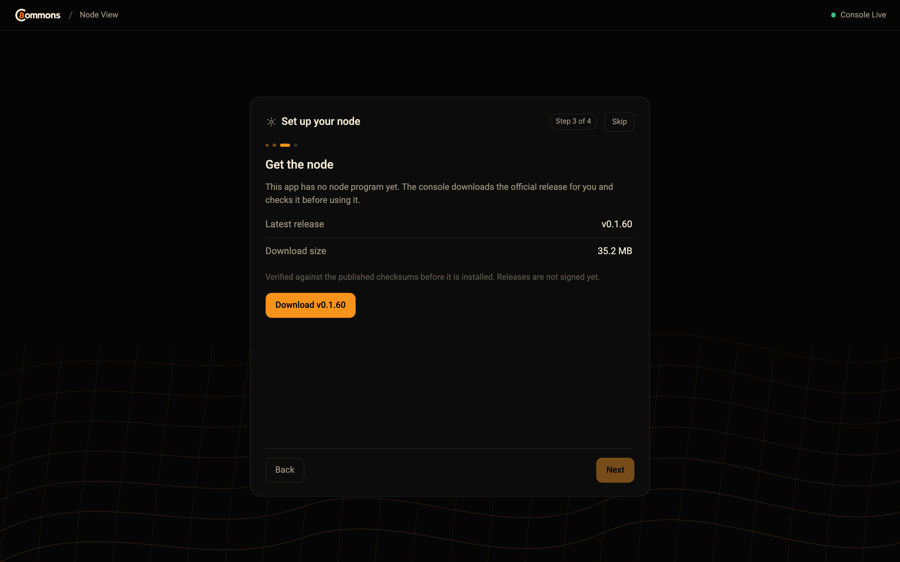 | 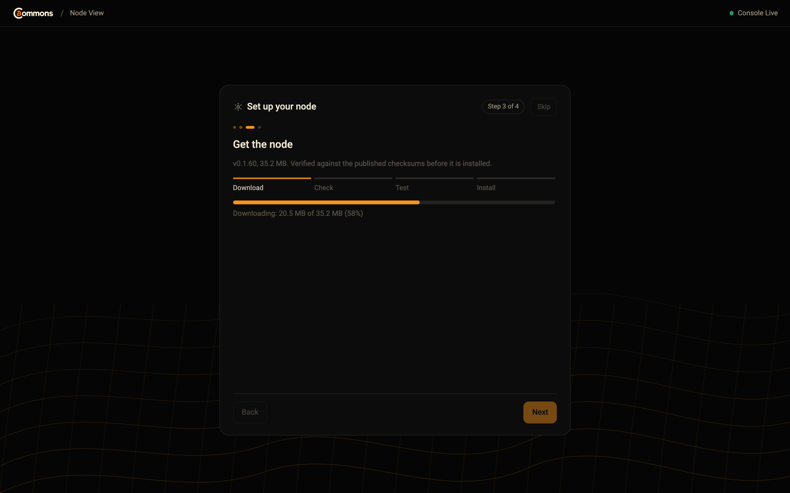 |

The console **remembers your choices** (in `console.json`, next to its other files). Setup runs once: after a restart,
the network, the data folder and the downloaded node are found again, and (unless you turned it off) the node starts by
itself, unless you stopped it: a node you stopped stays stopped after any restart. Setup shows up again only if you ask
for it (*Run setup again*), or while it was never finished and no network is chosen. *Skip* counts as finished, so after
it the page stays away and the Node card says that no network has been chosen.

On Umbrel the setup has fewer steps (the mode, the data folder and the modules are fixed or come later): welcome,
network, get the node, summary. *Skip for now* there only marks the setup as done: the app always runs its own node, so
it cannot be switched to watching another one. If GitHub cannot be reached the *Get the node* step says so and offers
*Try again* (which asks for a fresh check instead of the cached answer). Finishing the setup without starting the node
is fine even before a node program has been downloaded; starting one needs it.

## The pages

### Home and Insights

Home shows sync progress for the chain the node is on, local and network height, and a live ring with the inbound and
outbound peer split. Behind it a globe shows where your peers are (country level, looked up offline) and where you are.
The **Latest Blocks** rail slides a new block in as the node connects it; while the node is catching up, fast stretches
show as ranges instead of one tile per height.

| Synced or catching up | Mid-sync |
|---|---|
|  | 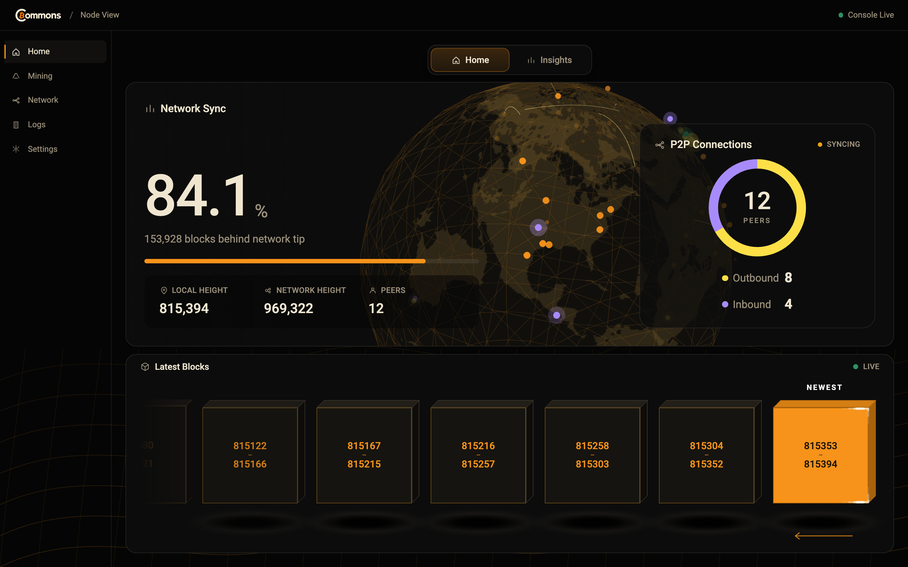 |

**Insights** has system health (status, uptime, node version, chain, initial-download state), inbound against outbound
peers, how much disk the chain uses next to the free space on its volume, and how many blocks arrived in each of the last
12 minutes. With a managed node the chain size is **measured**: what the network's folder takes on disk (refreshed about
once a minute), and the free space is that of the volume holding the data root. The node's own `size_on_disk` is not used
there: the official `blvm` release computes it as an estimate of about 1 MB per block, which was off by a factor of 2 to 8
on real chains (102 GB reported against 12 GB on disk at 99 000 blocks). With a standalone node the console measures the
node's data folder when it can find it, and otherwise shows the node's figure, labelled "reported by the node".

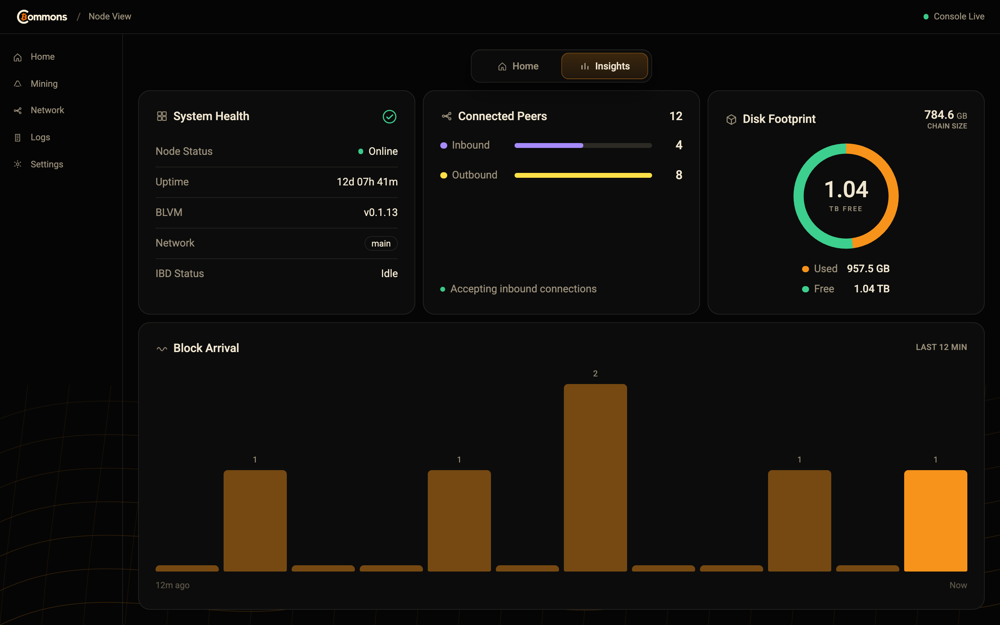

### Network

Everything about peers: the P2P overview with a switch to turn networking off, add a peer, block an address for 24
hours, and full lists of connected and blocked peers with disconnect, block and unban actions.

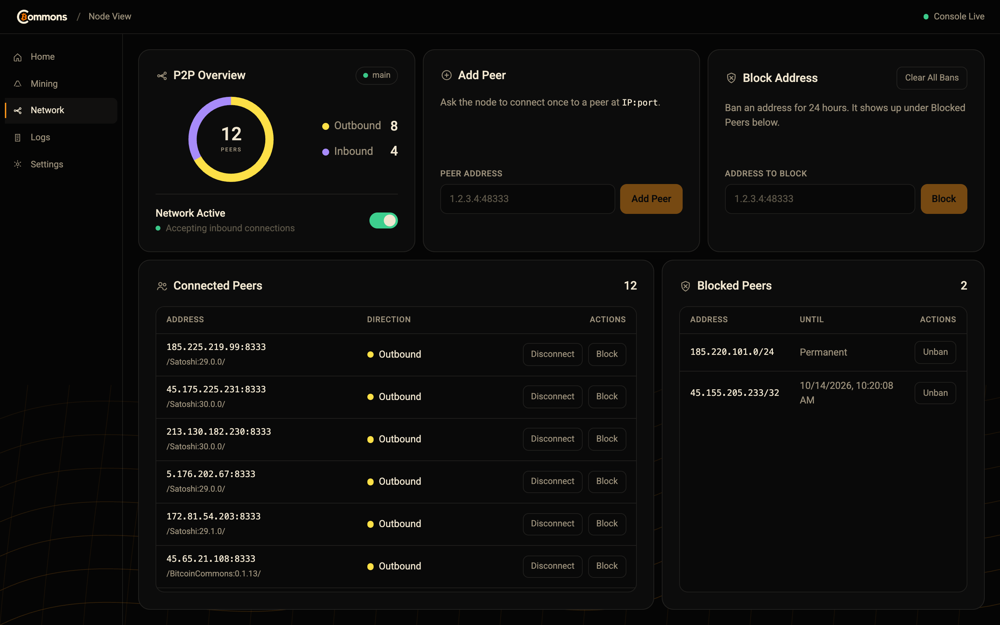

### Settings

What you see depends on the mode.

**Managed** (the node is the console's):

* **Node.** Running, stopped, starting or crashed, with the network, the installed version, uptime and Start, Stop and
  Restart. Two switches on the desktop: *Start the node when this app starts* (it applies only when you left the node
  running: a node you stopped stays stopped) and *Stop the node when this console quits*. Neither is shown on Umbrel,
  where the node belongs to its own container and its agent brings back what you left running, whatever this app is set
  to; the card says so in one line. If the node agent of an Umbrel app stops answering, the card and the top light say so. If the node
  crashed, the card shows the last log lines and *Try again*; if another program holds the node's port, it says which
  program and refuses to start.
* **Network.** A carousel of the networks. Picking another one asks first: it shows what the current network keeps on
  disk, where the new one will continue from, and how much disk is free, then stops the node cleanly, **keeps the data
  of the network you leave**, and starts the other. Switching back picks up where it stopped. A switch is refused when
  less than 5 GB is free.
* **Updates.** Installed version, latest release, and *Update to vX* when a newer one exists. The update downloads,
  checks, tests the new program, installs it, restarts the node, and **puts the old program back by itself** if the new
  one does not come up. On Linux only (see below). When updates are turned off, or left to an app store (`BLVM_UI_UPDATES`), the card says
  so.
* **Modules.** Add-ons that run next to the node. Installing them is not available yet; the screenshot of this card is
  mock data. Mining appears in the sidebar only once a mining module is installed and on.
* **Console.** *Show the Logs page* (off by default; `show_logs` in `console.json`). Part of the sidebar rules: Home, Network,
  Settings are always there, Logs when the switch is on, and a module's page (Mining) when that module is installed and on.
* **About.** Chain, node RPC, versions, uptime, and a per-network **Storage** list with free disk and the data folder.
  *Run setup again* is here.

| Settings | Switching networks |
|---|---|
|  | 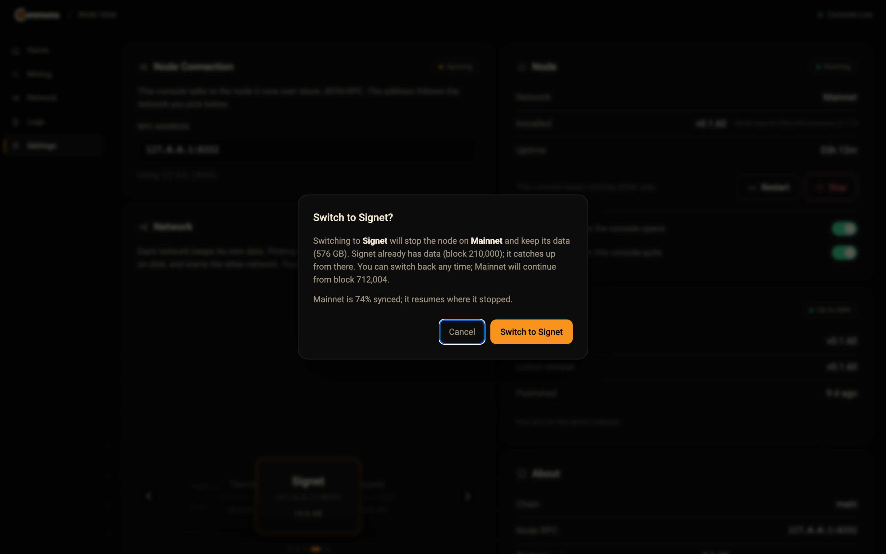 |

| Updates | Modules |
|---|---|
| 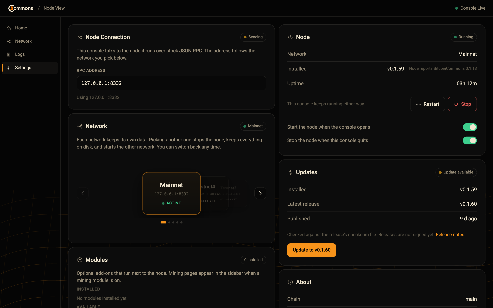 | 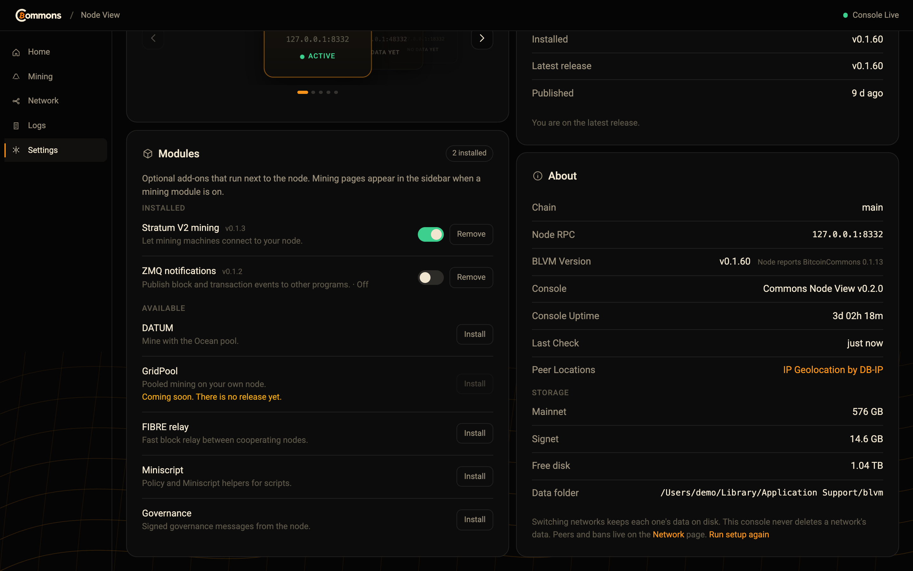 |

**Standalone** (you run the node): which RPC address the console talks to, a carousel of the usual local RPC ports per
chain (Mainnet, Testnet4, Testnet3, Signet, Regtest), a button that stops or starts the node process if it is on this
computer (Unix only), and version and uptime details.

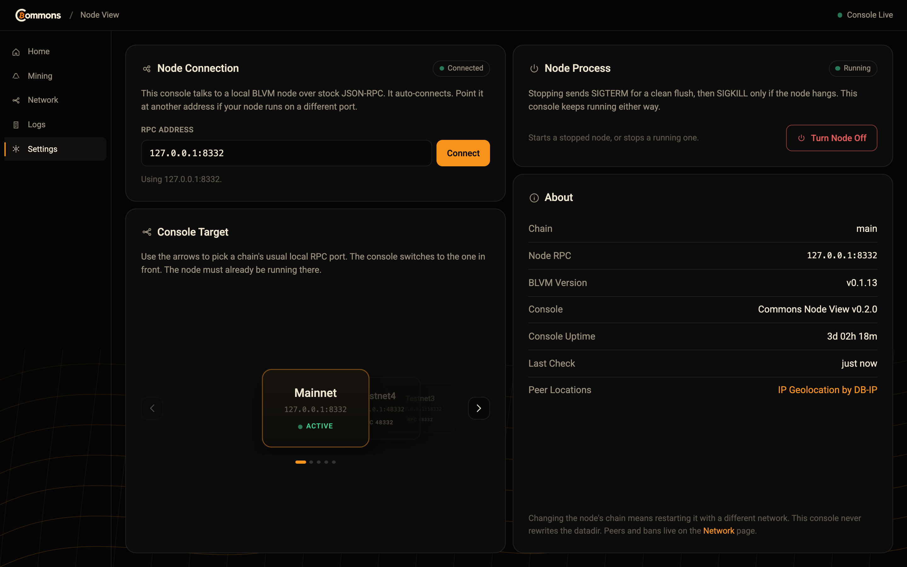

### Logs

The Logs page is **off by default**: *Show the Logs page* in Settings (the *Console* card) puts it in the sidebar, and a
typed `#logs` while it is off shows a note with a button to turn it on. With a managed node the page **tails the node's
log live**, starting with the last 500 lines of the file (also those written before the console started), next to a short guide to the lines worth watching. The
full file is `networks/<network>/logs/node.log` in the data folder (copy-truncated at 50 MB, one older file kept), and
the page has a button to copy its path. With a standalone node the console cannot see the node's output, so the page
shows the commands to run your node with verbose output, save it and follow it. A line such as "RPC authentication is
required but no tokens or certificates are configured" in the node's log is an upstream wording issue: with the login
this console gives the node, Basic authentication is in effect (a call without it gets `401`).

The node does not inherit the console's own `RUST_LOG` (the container image sets one that names only the console, which
silenced every line the node wrote); give the node one with *Child environment* (`child_env`) if you want a different level.

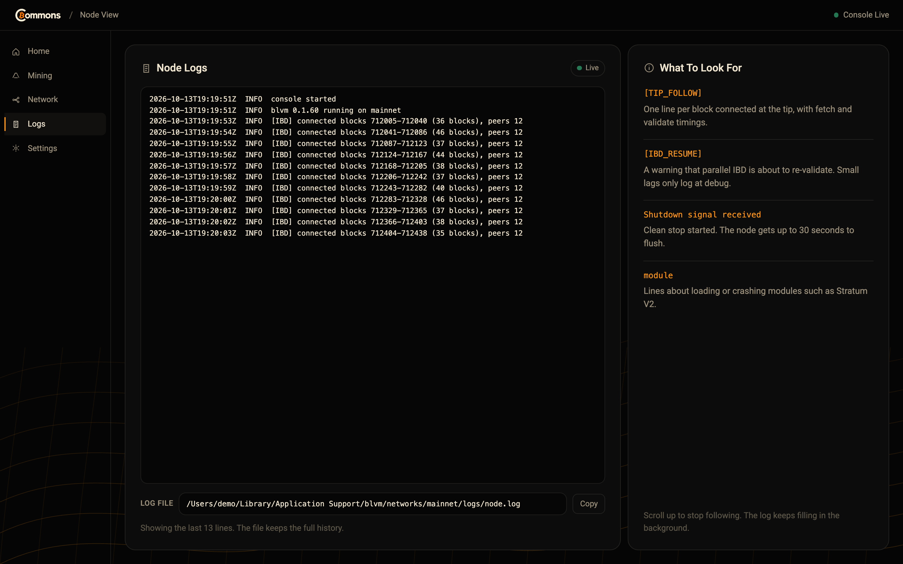

### Mining

Shown in the sidebar only once a mining module is installed and on (the sidebar is otherwise Home, Network, Logs, Settings;
a typed `#mining` without a module shows a note pointing to Settings). An information page about the Stratum V2 endpoint and the Commons pool: commands to run, no live numbers. Nothing live is
wired to it yet.

### Status lights

* **Green**: RPC up, at the tip, has peers.
* **Amber**: syncing (initial block download), catching up after being synced, no peers, or still looking for the node.
* **Red**: the node is down or not answering RPC (**Frozen** when the port is open but RPC hangs).

The console does **not** die when the node dies. It keeps the last known numbers, dims them, and offers a manual connect
field.

## Umbrel

Commons Node View is in the **Bitcoin Commons community app store**:
[`BTCDecoded/commons-umbrel-store`](https://github.com/BTCDecoded/commons-umbrel-store).

1. In umbrelOS open the **App Store**, then **⋯** (top right), then **Community App Stores**.
2. Add `https://github.com/BTCDecoded/commons-umbrel-store`.
3. Open **Bitcoin Commons App Store** and install **Commons Node View**.

What you get:

* **Two containers** from the same image (`ghcr.io/btcdecoded/blvm-ui`): `web` is this console, behind Umbrel's login on
  port 3849; `agent` runs the node. They share one data folder (`/data`, Umbrel's app data folder). Either one can
  restart or crash without taking the other down: restarting the console never touches the node, and stopping the app
  asks the node to finish saving first (the agent waits up to 200 s; Docker allows 240 s). The node runs **inside the
  agent container**: restarting that container restarts the node, and a node is only taken over again when the agent
  process restarts inside a running container (a `kill -9` of the agent), not after a container restart. Your last
  Start or Stop is kept: a node you stopped stays stopped after an app restart, an update or a reboot. There is no
  *Start the node when this app starts* switch here: the agent restores `control/desired.json` by itself, so a switch
  would change nothing.
* **The node is not in the image.** It is downloaded on first setup, when you pick a network, from the official
  [BLVM releases](https://github.com/BTCDecoded/blvm/releases) by the web container, checked against the release's
  published checksum (releases are not signed yet), and kept under `/data/bin`; the agent runs it. Updates are installed the same way when you click, so the app's version and the node's version are
  independent.
* **Ports.** Umbrel fixes ports in the app's compose file, but you choose the network later, so the node container
  publishes all five peer-to-peer ports: 8333 (Mainnet), 18333 (Testnet3), 48333 (Testnet4), 38333 (Signet) and 18444
  (Regtest). Only the one for your network has a node behind it. The node's RPC port is **not** published, and it answers
  only with a login (see below): other apps on Umbrel's shared Docker network cannot call it.
* **Port 8333.** Umbrel's own *Bitcoin Node* app uses 8333 too. While it runs, this app cannot start at all (the agent
  publishes all five ports), whichever network you pick: stop Bitcoin Node first.
* **Commons UI.** The older *Commons UI* app uses the same web port, 3849. Uninstall it before installing this one.

The store's README and notes explain how the app is put together (the `btc-commons-node-view` folder of the store
repository above, once the store branch with it is merged). In the
container the console runs in managed mode with `BLVM_UI_AGENT=external` (see [the node agent](#the-node-agent-in-process-or-in-another-container)).

## Desktop

The desktop console is the same program, run on your own computer, in standalone or managed mode.

* **Linux (x86_64 and aarch64): standalone or managed.** A desktop bundle is a folder with the `blvm-ui-next` program,
  the built page (`web/`), and a `blvm-bundle.toml` marker. In managed mode the console downloads the node on first
  setup (or uses a `blvm` program that sits next to it). The node needs glibc 2.39 or newer (Ubuntu 24.04, Debian 13).
  Downloadable bundles from GitHub releases are planned; until one is published, build it from source (below).
* **macOS: standalone only, for now.** There is no macOS build of the node to download yet, so the console cannot
  install one there. Run your own node and point the console at it. (If you built a node yourself you can still use
  managed mode with `BLVM_UI_NODE_BIN=/path/to/blvm`; the installer and updates stay off.)
* **Windows:** the page and the console work and can watch a node. Starting, stopping and adopting a node from the
  console is built for Unix only (the Windows build has no signal handling for it), so it does not work there.

To run it in managed mode with your own data folder:

```bash
BLVM_UI_MODE=managed BLVM_UI_DATA_ROOT=$HOME/blvm-data ./blvm-ui-next
```

then open **http://127.0.0.1:3849**. Without `BLVM_UI_DATA_ROOT` the data goes to `~/.local/share/blvm` (Linux) or
`~/Library/Application Support/blvm` (macOS). The node itself, each network's chain data, its log and your settings all
live in that folder; see [the data folder](#the-data-folder) for the layout.

## Build and run from source

Requirements: Rust 1.88 or newer, and Node.js 20 or newer (to build the page). A node with JSON-RPC listening if you use
standalone mode: the default target is a BLVM Testnet4 node at `127.0.0.1:48332` and Mainnet is `127.0.0.1:8332`.
Bitcoin Node and Knots work too; give the console their RPC login (see [Configuration](#configuration)).

```bash
git clone https://github.com/BTCDecoded/blvm-ui.git
cd blvm-ui

# 1. Build the page (writes web/dist)
cd web && npm install && npm run build && cd ..

# 2. Run the console against your node
BLVM_UI_RPC=127.0.0.1:8332 cargo run --release
```

Open **http://127.0.0.1:3849**. The console auto-connects to `BLVM_UI_RPC` and you can switch targets from Settings. To
let it run the node instead: `BLVM_UI_MODE=managed cargo run --release`.

Optional: download the peer location database so peers show up on the globe (see [Peer locations](#peer-locations)).

### Running a release build

A release build needs the binary and the built front end next to each other:

```bash
cd web && npm ci && npm run build && cd ..
cargo build --release
mkdir -p dist/blvm-ui && cp target/release/blvm-ui-next dist/blvm-ui/ && cp -r web/dist dist/blvm-ui/web
cp geo/zone.tab dist/blvm-ui/  # optional; the time zone table is also built in
```

The host looks for the page in `$BLVM_UI_WEB_DIR`, then `web/`, `dist/` or `web/dist/` next to the binary, then this
crate's `web/dist`.

To make a bundle that manages a node on its own, put a file `blvm-bundle.toml` (optionally with a line such as
`version = "0.1.60"`) and a `blvm` program next to the console binary: with both present and nothing saying otherwise, the
console starts in managed mode.

### Docker

The `Dockerfile` builds the page, the location database and the binary into a small Ubuntu 24.04 image that runs as
UID 1000 and keeps its block history in `/data`. The Rust binary is cross-compiled, so a multi-arch build does not
need emulation.

```bash
docker buildx build --platform linux/amd64,linux/arm64 -t ghcr.io/btcdecoded/blvm-ui:dev .

docker run --rm -p 3849:3849 -v blvm-ui:/data \
  -e BLVM_UI_RPC=host.docker.internal:8332 \
  -e BLVM_UI_RPC_USER=user -e BLVM_UI_RPC_PASS=pass \
  ghcr.io/btcdecoded/blvm-ui:dev
```

The **Docker image** GitHub workflow (`.github/workflows/docker.yml`) builds both architectures on every push and
pull request and publishes to `ghcr.io/btcdecoded/blvm-ui`:

| Push | Image tags |
|---|---|
| tag `v0.1.0` | `0.1.0`, `latest` |
| `main` | `main`, `sha-<commit>` |
| pull request | built, not pushed |

The run summary prints the multi-arch digest to pin in the Umbrel app's `docker-compose.yml`. The plain image runs the console in
standalone mode, where the node is somewhere else and the power button has nothing to start; the Umbrel app runs the
same image twice in managed mode instead (see [Umbrel](#umbrel)).

### Building for other systems

The platform is picked by the Rust build target, so Linux, Docker (Umbrel, Start9) and macOS builds come from the same
code:

```bash
cargo build --release                                     # this machine
cargo build --release --target x86_64-unknown-linux-gnu   # Linux x86_64
cargo build --release --target aarch64-unknown-linux-gnu  # Linux ARM64
```

(Install a target once with `rustup target add …`.)

| Piece | Linux (incl. Docker) | macOS / other Unix | Windows |
|---|---|---|---|
| Find / stop / restart the node | reads `/proc` (no `lsof`/`ps` needed), falls back to them | `lsof` + `ps` | not supported |
| Block history file | `$XDG_STATE_HOME` or `~/.local/state/blvm-ui-next` | `~/Library/Application Support/blvm-ui-next` | `%APPDATA%\blvm-ui-next` |
| Time zone for the "You!" dot | `TZ`, `/etc/localtime`, `/etc/timezone` | `TZ`, `/etc/localtime` | `TZ` |

For Umbrel / Start9 containers, which usually run in UTC, use `BLVM_UI_SELF_GEO=fixed:…` or pass the host's `TZ`, and
point `BLVM_UI_STATE_DIR` at the app's persistent volume so history survives image updates.


## Development

Run the Rust host and the Vite dev server side by side. Vite proxies `/api` to the host, so the page reloads live as you
edit.

```bash
# terminal 1: host on :3849
BLVM_UI_RPC=127.0.0.1:48332 cargo run

# terminal 2: live-reloading page on http://127.0.0.1:5174
cd web && npm install && npm run dev
```

```bash
cargo test          # host tests (feed, sync %, persistence, geo, process control, managed mode, installer, agent)
cd web && npm run build
```

`VITE_API_PROXY` says where `/api` goes; it defaults to the host on `http://127.0.0.1:3849`. To develop the page with no
node and no Rust host, start the mock (below) and point the proxy at it:

```bash
VITE_API_PROXY=http://127.0.0.1:3850 npm run dev
```

### Mock host (no node needed)

`web/mock/server.mjs` serves the built page with a fake `/api/*` that looks like a real mainnet node: the current mainnet
tip (fetched from mempool.space at start, with a fallback), 8 outbound and 4 inbound peers around the world, disk usage,
and a new block every minute. The managed-node screens have in-memory state, so every button works.

```bash
cd web
npm run build
npm run mock                                  # http://127.0.0.1:3850
MOCK_SCENARIO=ibd npm run mock                # mid initial block download instead
MOCK_SCENARIO=managed-running npm run mock    # a managed node, with Settings, Logs and the switch dialog
```

Other knobs for `/__mock`: `offline=1` (GitHub cannot be reached: the *Get the node* step offers *Try again*, which asks `GET /api/node/releases?force=1`; `force_checks` in the answer counts those), `agent_alive=0`. Switch scenario while it runs and reload the page: `curl "http://127.0.0.1:3850/__mock?scenario=update-available"`.

| Scenario | What it shows |
|---|---|
| `synced`, `ibd` | a node you run yourself, at the tip or mid-sync (answers like a host from before managed mode) |
| `first-run` | the setup (add `&external=1` for the Umbrel-style three-step setup) |
| `managed-no-binary` | first run with no node program on disk: the *Get the node* step (download, check, test, install over a few seconds; `&external=1` for the Umbrel flow, `&platform_supported=0` for the unsupported-platform message) |
| `managed-stopped` | managed, no network chosen yet |
| `managed-running` | a managed Mainnet node mid-sync (add `&external=1&agent_alive=0` for an Umbrel app whose node agent stopped answering) |
| `managed-switching` | a Mainnet to Signet switch in progress |
| `managed-crashed` | a Testnet4 node that crashed, with the last log lines |
| `port-conflict` | a start refused because another program holds the node's port |
| `update-available` | running v0.1.59 with v0.1.60 out; *Update* runs the whole job |
| `updates-off` | updates left to an app store (`BLVM_UI_UPDATES=store`) |
| `modules` | two modules installed (mock-only routes: the real host does not install modules yet) |

Extra knobs go on the same URL (`&free_gb=3`, `&fail_verify=1`, `&fail_test=1`, `&fail_start=1`, `&stop_stuck=1`,
`&slow=20`, `&channel=self|store|off`, `&can_install=0`, `&custom=1`; the header of `web/mock/server.mjs` lists them all).

| Variable | Meaning | Default |
|---|---|---|
| `MOCK_PORT` | listen port | `3850` |
| `MOCK_SCENARIO` | one of the scenarios above | `synced` |
| `MOCK_DIST` | folder with the built page | `web/dist` |
| `MOCK_TIP` | tip height; skips the network lookup | live tip |
| `MOCK_BLOCK_SECS` | seconds between new blocks when synced, `0` to freeze | `60` |

### Screenshots

```bash
cd web && npm run build && npm run screenshots
```

Starts its own mock server and captures every page and the main cards in both the synced and syncing states, 2x pixel
density, into `screenshots/`. `SCREENSHOT_SIZE=1440x900` gives the size the Umbrel store gallery uses. It uses a
Chromium-family browser already on the machine (Chrome, Chromium, Brave or Edge); set `BROWSER_PATH` to choose one, or
`SCREENSHOT_DIR` to change the output folder. The images in `docs/screenshots/` are 1440x900 at 2x of the scenarios
named above: `home` and `settings-managed` from `managed-running`, `ibd-home` from `ibd`, `setup-network` from
`first-run&external=1`, `setup-get-node*` from `managed-no-binary&external=1`, `settings-updates` from
`update-available`, `settings-modules` from `modules`, and the rest from `synced`.

## Configuration

All settings are environment variables. Runtime ones, for the console:

| Variable | Meaning | Default |
|---|---|---|
| `BLVM_UI_LISTEN` | address the console listens on | `127.0.0.1:3849` |
| `BLVM_UI_RPC` | node JSON-RPC address (the standalone target) | `127.0.0.1:48332` |
| `BLVM_UI_RPC_USER` / `BLVM_UI_RPC_PASS` | the console's RPC login, for nodes that need one (Bitcoin Node, Knots, Umbrel). In managed mode they are also the login the console gives the node it starts; without them it generates a pair (see [The node's RPC login](#the-nodes-rpc-login)) | none |
| `BLVM_UI_RPC_COOKIE` | path to the node's `.cookie` file, used when no user is set; re-read on every call | none |
| `BLVM_UI_WEB_DIR` | folder holding the built page | `web/`, `dist/` or `web/dist/` next to the binary, then this crate's `web/dist` |
| `BLVM_UI_MODE` | `standalone` (you run the node) or `managed` (the console runs it); `BLVM_UI_MANAGED=1` is an alias | `console.json`, then a bundle marker, then `standalone` |
| `BLVM_UI_NODE_BIN` | the node program: used by **Turn Node On** (standalone) and as *the* program in managed mode. When set, the in-app installer refuses (it would write where the console does not look) | auto-detected (standalone); next to the console in a bundle |
| `BLVM_UI_NODE_CWD` | working directory for that node (standalone only; a managed node always runs in `<data root>/networks/<network>/`) | auto-detected |
| `BLVM_UI_DATA_ROOT` | managed: folder holding every network's data and logs, the downloaded node and the control files ([layout](#the-data-folder)) | `~/.local/share/blvm` (Linux), `~/Library/Application Support/blvm` (macOS), `%APPDATA%\blvm` (Windows) |
| `BLVM_UI_STATE_DIR` | folder for `console.json` (your settings), `feeds.json` (Latest Blocks history) and `releases.json` (release check cache). Managed mode without it: `<data root>/console/` (a console that already has a `console.json` or `feeds.json` in the per-user folder keeps that folder until the new one has files of its own) | `$XDG_STATE_HOME/blvm-ui-next` or `~/.local/state/blvm-ui-next` (Linux), `~/Library/Application Support/blvm-ui-next` (macOS), `%APPDATA%\blvm-ui-next` (Windows) |
| `BLVM_UI_AGENT` | managed: `external` means the node runs under `blvm-ui-next agent` in another container and this process spawns nothing ([details](#the-node-agent-in-process-or-in-another-container)); anything else runs the node inside this process | in-process |
| `BLVM_UI_NODE_HOST` | with `BLVM_UI_AGENT=external`: host name of the agent's container; the console polls `<host>:<network's RPC port>` | `btc-commons-node-view_agent_1` |
| `BLVM_UI_NODE_VERSION` | managed: release version to show for the node program (set by packages that ship a known release) | none (shown as "Custom build") |
| `BLVM_UI_UPDATES` | in-app node installs and updates: `1` (on), `0` (off), `store` (done by the app store instead). Wins over `console.json`. The first install is always allowed; this governs updates once a release is installed | `1` |
| `BLVM_UI_ALLOWED_HOSTS` | comma-separated host names (no port) that may use the console besides localhost. **Once it is set, every IP address and every `*.onion` name is accepted too**, and the single token `*` accepts any `Host`. See [Security](#security) | none (loopback only) |
| `BLVM_UI_SETUP` | `skip` hides the first-run setup | unset |
| `BLVM_UI_PLATFORM` | testing only: pretend to be `linux-x86_64`, `linux-aarch64` or `unsupported` when choosing the release file | detected |
| `BLVM_UI_GEO_DB` | path to the `.mmdb` peer location file | `geo/dbip-country-lite.mmdb` next to the binary, then this crate's `geo/` |
| `BLVM_UI_SELF_GEO` | where the "You!" dot goes: `auto` (node-reported IP, else time zone), `ip`, `timezone`, `fixed:LAT,LON[,Label]`, `off`. Can also be set at build time (`BLVM_UI_SELF_GEO=fixed:52.52,13.405,Berlin cargo build --release`); a runtime value wins | `auto` |
| `RUST_LOG` | host log filter | `blvm_ui_next=info` |

For the node agent (`blvm-ui-next agent`, the node container of the Umbrel app):

| Variable | Meaning | Default |
|---|---|---|
| `BLVM_AGENT_RPC_BIND` | address the node's RPC server binds to (`--rpc-addr <bind>:<port>`); `0.0.0.0` so the console container can reach it | `127.0.0.1` |
| `BLVM_AGENT_BUNDLED_BIN` | program to run when `<root>/bin/blvm` does not exist (for example one baked into an image) | none |
| `BLVM_RPC_USER` / `BLVM_RPC_PASS` | the node's RPC login. The agent writes them into the node's config file before every start (see [The node's RPC login](#the-nodes-rpc-login)). A node that listens beyond loopback is not started without them | none |

The agent also reads `BLVM_UI_DATA_ROOT` (or `--root DIR`, else `/data`). Only one agent can run on a data folder
(`control/agent.lock`); a second one exits with a message.

The setup appears on its own in two cases: a managed console with no network chosen yet, and a fresh standalone install
that has a node program to offer (a bundle, or `BLVM_UI_NODE_BIN`). A state folder that already holds `feeds.json` or
`console.json` (a console from before the setup existed), `BLVM_UI_RPC`, `BLVM_UI_MODE=standalone`, or a console with no
node program all skip it. **Run setup again** and **Use a managed node** in Settings open it on purpose.

## Security

The console **only listens on localhost by default**. It can start, stop and update your node and change peer settings, so
do not expose it to a network you do not trust.

Every request that changes something (`POST`/`PUT`) must have `Content-Type: application/json`, a `Host` that is
localhost (or listed in `BLVM_UI_ALLOWED_HOSTS`), and, when the browser sends one, an `Origin` on such a host. Every
other route (see the [API](#api) table) also needs the header `X-BLVM-UI: 1` (`X-Commons-UI: 1` works too); the page
sends it on every post. For `/api/node`, `/api/connect` and `/api/rpc` the header is not enforced yet: set `REQUIRE_UI_HEADER_ON_LEGACY_ROUTES` to
`true` in `src/http.rs` (one line) once the page that sends it is what you serve. If you reach the console over a LAN
address or a name, add that name to `BLVM_UI_ALLOWED_HOSTS` or the post is refused.

**LAN, Umbrel and Tor.** Every `/api/*` request, reads included (`/api/status` too), is answered `403` unless its `Host` is
localhost or listed in `BLVM_UI_ALLOWED_HOSTS`. The `403` text names the variable, the page shows it, and the console
logs a warning at startup when `BLVM_UI_LISTEN` is reachable from other computers (not a loopback address) while the
variable is unset. For the Umbrel compose file (the app proxy forwards the app's host name as `Host`), set it before
upgrading, for example:

```yaml
environment:
  BLVM_UI_LISTEN: 0.0.0.0:3849
  BLVM_UI_ALLOWED_HOSTS: umbrel.local,btc-commons-blvm-ui_web_1   # every name the browser or the proxy uses, no port
```

Without it the page loads but power, connect and the status itself are refused. Behind a gateway that passes the
browser's own `Host` through (Umbrel does), people reach the app by name, by LAN address (`192.168.1.5:3849`) or over Tor
(`*.onion`): once `BLVM_UI_ALLOWED_HOSTS` lists at least one name, every IP-address `Host` and every `*.onion` `Host` is
accepted too (the same goes for `Origin`), and the token `*` accepts any `Host`. With the variable unset only loopback
works, as before.

An `/api/*` path the console does not have answers `404` with a JSON body (never the page), and a request body larger
than 64 KiB is `413`; the cards for features a smaller host lacks (updates, modules) say "not available".

**Downloads are checked, not signed.** The node program the console downloads comes only from
`github.com/BTCDecoded/blvm/releases/download/` (redirects only to GitHub hosts, at most 120 MB). It is verified against the
published checksums, so you know it is the file the release lists; **releases are not signed yet**, so this does not prove
who built it. The program is also run once (`--version`) before it is installed, and an update that does not come up is
rolled back.

## Managed mode in detail

By default the console only watches a node you run yourself (**standalone**). In **managed** mode it also starts, stops
and restarts one `blvm` binary for you, keeps each network's data in its own folder, and writes the node's output to a
log file. [First start](#first-start) describes the setup walkthrough.

How the mode is chosen, first match wins:

1. `BLVM_UI_MODE=managed|standalone`
2. the `mode` saved in `console.json` (in the state directory, next to `feeds.json`; written by the wizard and Settings)
3. a file `blvm-bundle.toml` next to the console executable **and** a `blvm` binary beside it: managed
4. otherwise standalone

### The data folder

Layout under the data root (`BLVM_UI_DATA_ROOT`; on Umbrel `/data`, shared by both containers):

```
bin/blvm                       link to the program in use (the in-app installer keeps it current)
bin/blvm-v0.1.60               downloaded release programs (the last two are kept)
bin/installed.json             {tag, asset, sha256, installed_at, previous_tag} of the program in bin/blvm
bin/staging/<tag>/             a download in progress (deleted when it ends)
control/desired.json           what the console wants running (written by the console)
control/state.json             what the agent reports (written by the agent, every 2 s and on change)
control/node.pid               which node process the agent started (a restarted agent or console adopts it)
control/agent.pid              the `agent` process (only with the `agent` subcommand)
console/console.json           the console's settings (managed mode without BLVM_UI_STATE_DIR); also feeds.json, releases.json
networks/<network>/            the node's working directory
networks/<network>/data/       chain data  (--data-dir ./data)
networks/<network>/logs/node.log   everything the node prints (copy-truncated at 50 MB, one .1 kept)
networks/<network>/meta.json   first use, last use, last height the console saw (see below)
```

A restart never repeats the setup: `console.json` remembers `setup_done`, the network and the other choices, the node
program is found again in `bin/blvm`, and with **start the node when the console starts** (`start_on_boot`, on by
default in managed mode) the node starts by itself, provided you did not leave it stopped (`node_wanted` in
`console.json`: set by Start, Restart, a network switch and a setup that starts the node, cleared by Stop and by a setup
that does not). With an external agent the agent restores its own `desired.json` by itself, so the console writes
nothing when that file exists, and writes `running: true` only for a setup that was never applied. Nothing is started
when no network has been chosen or no node program exists yet.

There is **no default network**: the console never starts a node until a network was chosen (`mainnet`, `testnet4`,
`testnet`, `signet`, `regtest`). The node is started as
`blvm --network <n> --data-dir ./data --rpc-addr 127.0.0.1:<port> --listen-addr 0.0.0.0:<p2p port> --config ./blvm.toml` (plus `--noassumevalid` on Testnet4 and regtest) with
`BLVM_SCHNORR_PER_SIG=1` in its environment (upstream's default collector mode skips Taproot signature checks; the
per-signature mode is the complete one). Both can be changed in `console.json`: `assume_valid` (`default`, `off`, a
height or a block hash) and `child_env` (`{"NAME":"value"}`; an empty value removes the variable).

Before it spawns anything the console checks that the network's RPC and P2P ports are free. If another program holds one
the start is refused and the Node card says which ("The RPC port 48332 is in use by pid 4242 (blvm)"); it is never shown
as running, and the other program's height, peers and version are never shown as this node's (the same check repeats
while the node runs, a few seconds apart).

Process states: `stopped`, `starting` (until the node's RPC answers any method, and the answering listener is this
node's; the node waits about 30 s for peers first; a silent node is stopped after 180 s, but a node that is alive and
still writing its log is waited for, 15 minutes at most), `running`, `stopping` (SIGTERM, then SIGKILL after 200 s; the node needs up to 30 s to save state) and
`crashed`. A crash is restarted after 5 s, 30 s and 120 s (the node's whole process group, modules included, is killed first); a
fourth crash within 10 minutes stays `crashed` with the last 50 log lines (terminal colour codes removed). Changing a
setting that needs a stopped node, or running setup, cancels a restart that is still waiting. SIGHUP (closing the
terminal) quits the console like SIGTERM, stopping the node unless `stop_node_on_exit` is `false`. When the console quits it stops the node first; set `stop_node_on_exit` to `false` (Settings, or
`console.json`) to leave it running. If the console itself dies the node keeps running, and the next console re-adopts it
from `control/node.pid`.

The version shown is never a guess: `blvm_version` is `"—"` whenever the node is not answering, and the version it last
reported moves to `blvm_version_seen` (`{version, at}`). In managed mode the version of the binary comes from running
`<bin> version` (at start, and again when the file changes).

### Switching networks

Each network lives in its own folder, so switching never deletes anything. In **Settings, Network**, pick another
network on the carousel: the console asks first and shows what it knows (how much the current network keeps on disk,
the block it will continue from, whether the new one already has data, free disk, and a warning where it applies, for
example that Testnet4 checks every block in full). On Confirm:

1. **Stopping**: the current node gets a graceful stop (SIGTERM, up to 200 s, the same as the Stop button) and its
   data stays where it is. A node that is already stopped skips this step.
2. **Starting**: the console saves the new network, points its own polling at that network's RPC port, and starts the
   node in `networks/<new>/` with that network's own arguments (`--noassumevalid` on Testnet4 and regtest, plus your
   `assume_valid` and `child_env` settings). The page follows by itself: Home shows the new network's sync state, and
   Latest Blocks shows that network's saved history, because history is kept per RPC address.
3. **Done**, or **Failed** with the last 50 log lines and a **Try again** button.

`managed.switch` in `/api/status` carries `{id, from, to, phase, started, error?, log?}` while this runs and for 30
seconds after it ends. While it runs the Start/Stop/Restart buttons, setup, and network changes in `/api/settings` are
refused, and a second switch is answered `409 busy`. Details that are easy to ask about:

* The saved network (`console.json`) changes only after the new node has actually been spawned. If the old node does
  not stop in time (a plain stop already allows 200 s plus a SIGKILL), or the new node cannot be spawned, the switch
  fails and the old network stays chosen. If the console itself quits in the middle, the next start sees whichever
  network was saved last: the old one before the spawn, the new one after it (that node is then re-adopted from
  `control/node.pid`).
* If the new node crashes, stops by itself or never answers (180 s), the switch is `failed`. The console already
  follows the new network at that point; the automatic crash restart is cancelled so it cannot race with the button,
  and **Try again** starts that node again.
* A switch asked for while the node is `starting`, `stopping`, or waiting to restart after a crash is accepted: it
  cancels any queued restart, waits for the old process to be gone, and goes on.
* A switch while the node is stopped skips the stopping step and still starts the new network.
* Switching to the network you are on, with under 5 GB free on the data volume, or before any network was chosen is
  refused (the preview says why in `reason`).

`meta.json` is `{created, last_used, last_height, last_header}` (unix seconds and block heights). The console writes it
when a node starts, stops or is adopted, and every 60 s while one runs; `last_height` is the height of the last
successful RPC poll. It lets the switch dialog and the network table say "block 712 004" for a network whose node is off.
The network table in `/api/status` (`managed.networks[]`) is filled from these folders: `bytes` (allocated size,
measured every 60 s), `has_data` (chain files exist, beyond the node's empty module folder), `last_height`, `last_used`.

### Installing and updating the node

In managed mode the console can download the official node from the GitHub releases of `BTCDecoded/blvm` (Linux x86_64
and aarch64 only: there is no macOS or Windows build, and the program needs glibc 2.39 or newer, i.e. Ubuntu 24.04 or
Debian 13). The release list comes from `api.github.com` (no token, cached ten minutes in memory and in `releases.json`,
the last answer is used when GitHub cannot be reached). `POST /api/node/install` (the first install, any channel) and
`POST /api/node/update` (a newer release; follows the `updates` channel) run one job at a time:

1. **download** the raw asset `blvm-<version>-<platform>` to `bin/staging/<tag>/` (at most 120 MB; only from
   `github.com/BTCDecoded/blvm/releases/download/`, redirects only to GitHub hosts; `bytes`/`total` progress);
2. **verify** its SHA-256 against the release's `checksums.sha256` (or `SHA256SUMS-blvm-<platform>`); a mismatch
   deletes the download. Releases are not signed yet: this only proves the file is the one the release lists;
3. **test** runs the new program once (`--version`, then `version`); it must exit 0 and print a version. A wrong CPU or a
   too-old glibc is reported here with the system's words, and nothing is installed;
4. **install** moves it to `bin/blvm-<tag>`, swaps the link `bin/blvm` atomically, writes `bin/installed.json`, and
   keeps only the current and previous version on disk;
5. **restart** (only if a node was running) stops the node and starts it on the new program. If it crashes, stops,
   never answers its RPC, or crashes within `60 s` of first answering, the link is put back, the node is started on the
   old program, and the job ends `failed` with `rolled_back: true`;
6. **done** or **failed** with `error` in plain words.

The version shown to the user is the installed release tag (`managed.node_version`, `v0.1.60`); a program that did not
come from the installer (`BLVM_UI_NODE_BIN`, a setting, a bundle) is a "custom build". When `BLVM_UI_NODE_BIN` is set the
installer refuses (it would write somewhere the console does not look). The installer works the same with an external
agent: the program lands in the shared `bin/` and the node is restarted through `desired.json`.

### The node agent: in-process or in another container

* **In-process** (default): the console itself starts, watches and stops the node. Nothing needs configuring.
* **External** (`BLVM_UI_AGENT=external`, used by the Umbrel app): the node runs in a second container that mounts the
  same data folder and runs `blvm-ui-next agent --root /data`. The node lives **inside that container**: restarting the
  container restarts the node. The console then spawns nothing: start, stop, restart and
  switch write `control/desired.json` (`{generation, network, running, binary, env, assume_valid, stop_grace_secs,
  rpc_port, restart_id}`), the process state is read from `control/state.json`, logs are read from the shared
  `networks/<network>/logs/node.log`, and the port-conflict check is skipped (the agent does it next to the node). The
  console polls the node at `BLVM_UI_NODE_HOST:<rpc port>`. Restarting the console never touches the node; quitting
  the console never stops it.

`blvm-ui-next agent [--root DIR]` (DIR defaults to `$BLVM_UI_DATA_ROOT`, else `/data`) has no web server. It acts once
per new `desired.json` generation (start; stop; or stop then start when the network or `restart_id` changed), supervises
the node with the same machinery as the in-process agent (per-network folder, file logs, crash restarts after
5 s / 30 s / 120 s, three tries), adopts a node that outlived it (a `kill -9` of the agent process; in a container the
node dies with the container, because the agent's container is its parent) through `control/node.pid`, starts the node
again by itself after a container restart when `desired.json` says `running` (a node that was stopped while it was
saving is killed without a flush, so give Docker the 240 s grace the app's compose file sets), and
writes `state.json` (`{agent_version, heartbeat, generation, state, pid, since, network, exit_code, exit_signal,
restarts, last_error, conflict, adopted, crash_log, installed_version, installed_report, binary, binary_found,
restart_id}`) on every change and every 2 s. On SIGTERM it stops the node (SIGTERM, then SIGKILL after
`stop_grace_secs`, default 200 s), writes the final state and exits 0, leaving `desired.json` as it was.

| Variable (agent process) | Meaning | Default |
|---|---|---|
| `BLVM_AGENT_RPC_BIND` | address the node's RPC server binds to (`--rpc-addr <bind>:<port>`); `0.0.0.0` so the console container can reach it | `127.0.0.1` |
| `BLVM_AGENT_BUNDLED_BIN` | program to run when `<root>/bin/blvm` does not exist (for example the one baked into the node image) | none |

#### The node's RPC login

The node reads no environment variable for its RPC login: it only reads `[rpc_auth]` from a config file. So before every
start the agent (the in-process one too) writes `networks/<network>/blvm.toml` (mode 0600) and starts the node with
`--config ./blvm.toml`:

```toml
transport_preference = "tcponly"   # the one key the node insists on in a config file; "tcponly" is its own default

[rpc_auth]
required = true
username = "…"
password = "…"
```

* **Umbrel (external agent):** the login is `BLVM_RPC_USER` / `BLVM_RPC_PASS` on the agent container (Umbrel derives the
  password from the seed, see the store's `exports.sh`); the web container sends the same pair as `BLVM_UI_RPC_USER` /
  `BLVM_UI_RPC_PASS`. The agent binds the RPC to `BLVM_AGENT_RPC_BIND` (`0.0.0.0` there, because the console is in another
  container) and **refuses to start a node whose RPC would be reachable beyond loopback without a login**.
* **In-process (desktop):** the node's RPC stays on `127.0.0.1`. The console uses `BLVM_UI_RPC_USER` /
  `BLVM_UI_RPC_PASS` when both are set, else it generates a pair once (user `commons`, a random password) and keeps it in
  `console.json` (mode 0600). The page never shows it, and `/api/settings` and `/api/status` do not carry it.
* **Safety check:** once a node answers, the agent asks it for `getblockcount` without a login. If that works (the node
  did not apply the config file, for example because it could not parse it and fell back to its defaults), the node is
  stopped and the card says why. A request without or with a wrong login gets `401` from the real node (tested against
  the built `blvm` on regtest). Only an explicit `401` or `403` counts as "asks for a login": a dropped connection or
  a timeout (the node limits the connections of one address) is no answer, and the check is repeated a few seconds
  later before the node is called `running`.
* A node that is still running from before this version (desktop, in-process) has no login. The console creates one
  and saves it, then **restarts that node once** to turn it on: the node is adopted, it answers a caller without a
  password, so it is stopped and started again with the config file, and the Node card says "Restarted the node to turn
  on its RPC password." (the log has the same line). The safety check above keeps stopping a node that should have a
  login and does not. A start without a login (loopback only) deletes an old `blvm.toml` from the network folder,
  because the node reads that file from its working folder even when it is not told to.

Quick start (regtest, a node binary you built):

```bash
BLVM_UI_MODE=managed BLVM_UI_NODE_BIN=/path/to/blvm BLVM_UI_DATA_ROOT=/tmp/blvm-data cargo run --release
# then, from the page's wizard or with curl:
curl -s -H 'Content-Type: application/json' -H 'X-BLVM-UI: 1' \
  -d '{"mode":"managed","network":"regtest","start":true,"stop_on_exit":true}' http://127.0.0.1:3849/api/setup
```


## Peer locations

Offline, country-level IP lookup with the DB-IP Country Lite database (CC BY 4.0). It is a 4 MB download, about 8 MB
unpacked, and git-ignored. Download it once into `geo/`:

```bash
curl -L -o geo/dbip-country-lite.mmdb.gz https://download.db-ip.com/free/dbip-country-lite-YYYY-MM.mmdb.gz
gunzip geo/dbip-country-lite.mmdb.gz
```

Each country is drawn at the average of its time zone cities (from the built-in tzdb table), and peers in the same
country get a small fixed offset so their dots do not stack. The larger City Lite file also works; the country file is
used first when both are present. Without a file, the console runs normally and peers just have no dot on the globe.

## Latest Blocks history

Kept in `feeds.json`, one entry per node RPC address, so it survives page reloads, console restarts, rebuilds and
network switches. It is only cleared when:

- the node's height stays well below the saved height for about 15 seconds (the chain data dir was wiped), or
- the node reports a different chain on the same RPC address.

A node that briefly reports height 0 while restarting does not clear it.


## API

The page only uses these; they are handy for scripts too.

| Route | Does |
|---|---|
| `GET /api/status` | the full snapshot the page renders (sync, peers, disk, feed, health). `disk_used_*` is the chain size and `disk_used_source` says where it comes from: `"folder"` (measured, always in managed mode) or `"node"` (the node's own figure, an estimate in the official release) |
| `POST /api/connect` `{"rpc":"host:port"}` | point the console at another node |
| `POST /api/node` `{"action":"toggle"}` | start or stop the node process |
| `POST /api/rpc` `{"method":…,"params":[…]}` | pass-through for peer settings: `addnode`, `setban`, `clearbanned`, `disconnectnode`, `setnetworkactive` |
| `GET /api/status` (more) | adds `mode`, `setup_done`, `managed` (process state, pid, network or `null` before one is chosen, data root, free disk, `networks[]` with `bytes`, `has_data`, `last_height`, `last_used`, `switch`, node version, crash log; `null` when standalone), `modules_pages` (page ids of installed and enabled modules; `[]` while nothing can be installed), `show_logs`, `bundle_available`, `blvm_version_seen` |
| `POST /api/node` `{"action":"start"\|"stop"\|"restart"\|"toggle"}` | managed: returns at once, watch `managed.process.state`. Also `POST /api/node/start`, `/stop`, `/restart` |
| `GET /api/node/logs?after=<seq>&limit=200` | managed: `{lines:[{seq,text}],file}` from the in-memory tail of `node.log` (`lines=` also works); 404 when standalone |
| `GET /api/settings` | `console.json` as the console sees it (effective values, `env_locked`) |
| `GET /api/node/releases[?force=1]` (`force` skips the cache; the page's *Try again* uses it) | `{installed:{tag,installed_at}\|null, latest:{tag,published_at,notes_url}\|null, asset:{name,size,platform}\|null, platform:"linux-x86_64"\|"linux-aarch64"\|"unsupported", can_install, reason, available, channel}` plus `current`, `custom`, `platform_supported`, `checked_at`, `notes_url`, `stale`, `offline`, `check_error`. The first install is allowed on every channel; updates need `channel:"self"`. Offline: the cached answer with `stale:true`, or `latest:null`, `can_install:false` and the reason. `force=1` skips the cache at most once a minute |
| `POST /api/node/install` `{"tag"?:"v0.1.60","version"?:"0.1.60","downgrade"?:false}` | start the first install (newest release when no tag): `202 {ok:true,job}`; `409 {ok:false,error:"busy"}` while a job runs; `400 {ok:false,error}` in plain words (unsupported platform, nothing to install, already installed, `BLVM_UI_NODE_BIN` set, bad tag, offline, a tag GitHub does not know: `code:"no_such_release"`, an older tag than the installed one without `downgrade:true`: `code:"downgrade"`) |
| `POST /api/node/update` same body | update an installed release; also `400` when nothing was installed by the console, or the channel is `off`/`store` |
| `GET /api/node/install` (also `/api/node/update`) | the last job until a new one starts: `{phase:"idle"\|"download"\|"verify"\|"test"\|"install"\|"restart"\|"done"\|"failed", tag, bytes, total, error, rolled_back}` (also under `job`, with `kind`, `started`, `finished`). The same fields are in `managed.update` (with `available`, `latest`, `channel`) while a job runs and for 30 s after |
| `PUT` or `POST /api/settings` | patch: `mode`, `network`, `data_root`, `node_bin`, `rpc`, `rpc_overrides`, `start_on_boot` (alias `start_on_launch`; default on in managed mode), `stop_node_on_exit` (`keep_node_running_on_exit` is its inverse), `show_logs` (the Logs page switch, default `false`), `modules_disabled`, `updates`, `assume_valid`, `child_env`. `setup_done: true` alone just marks the setup as done (what *Skip* sends on Umbrel). Mode, network, data root and binary can only change while the node is stopped (409), and not while an install or update runs and not when an environment variable pins them (409) |
| `POST /api/setup` `{"mode":"managed","network":"regtest","data_root"?,"node_bin"?,"start":bool,"stop_on_exit":bool}` | the wizard's result: validates (managed needs a network; a binary only when `start` is true, so a setup that only records the choice works before a program is downloaded; standalone may carry `rpc`), writes `console.json`, creates the folders, starts the node only when `start` is true, and remembers whether the node was to run. Refused with 409 while an install or update runs |
| `POST /api/setup/test` `{"rpc":"host:port","user"?,"pass"?}` | one RPC check: `{ok,chain,height,version,error}` |
| `GET /api/network/preview?to=signet` (or `POST` with `{"to":"signet"}` / `{"network":"signet"}`) | managed: what the switch dialog shows: `{from,to,from_bytes,to_bytes,from_height,to_height,to_last_used,from_ibd_pct,free_bytes,estimate_bytes,blocked,warnings[],allowed,reason}`. `allowed:false` carries the plain reason (same network, a switch running, under 5 GB free, no network chosen). 404 when standalone, 400 for an unknown network |
| `POST /api/network/switch` `{"to":"signet"}` (`{"network":…}` also works) | managed: validates like the preview, then answers `202 {ok,id,switch,status}` and runs in the background (progress in `managed.switch`). `409 {error:"busy"}` while another switch runs; `400 {ok:false,error}` when refused for any other reason |

## Layout

```
src/          Rust host: HTTP server, RPC polling, snapshot, block feed, geo lookup, node process control
              (agent.rs node agent, agent_daemon.rs `agent` subcommand, control.rs control files, releases.rs +
              installer.rs node downloads, managed.rs / switch.rs managed mode)
web/src/      Svelte front end (App.svelte + one panel per page in lib/)
web/public/   logo, fonts, globe texture
web/mock/     mock API server and screenshot script
geo/          time zone table (+ the optional .mmdb you download)
docs/         screenshots used in this README (1440x900 at 2x, from the mock host)
Dockerfile    multi-arch container image (see Docker)
```


## License

MIT. See [LICENSE](LICENSE).
